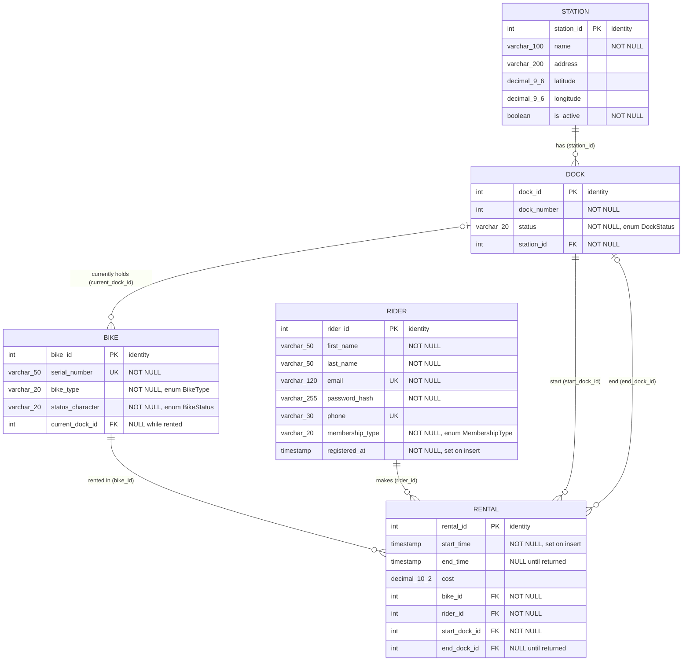

# City Bike – ERD

Renders on GitHub (Mermaid). Column names are the real DB columns.

## Relationships

| From | To | Cardinality | Notes |
|------|----|-------------|-------|
| Station | Dock | 1 – 0..N | Dock owns the FK; deleting a station cascades to its docks |
| Dock | Bike | 0..1 – 0..N | `Bike.currentDock`; null while the bike is out on a rental |
| Bike | Rental | 1 – 0..N | `Rental.bike`, required |
| Rider | Rental | 1 – 0..N | `Rental.rider`, required |
| Dock | Rental (start) | 1 – 0..N | `Rental.startDock`, required |
| Dock | Rental (end) | 0..1 – 0..N | `Rental.endDock`, null until the bike is returned |

## Table constraints

- `dock`: unique (`station_id`, `dock_number`)
- `rental`: check `end_time is null or end_time > start_time`
- Enums are stored as strings (`EnumType.STRING`):
  - `DockStatus`: AVAILABLE, OCCUPIED, OUT_OF_SERVICE
  - `BikeType`: STANDARD, ELECTRIC
  - `BikeStatus`: AVAILABLE, RENTED, MAINTENANCE
  - `MembershipType`: PAY_AS_YOU_GO, MONTHLY, ANNUAL
