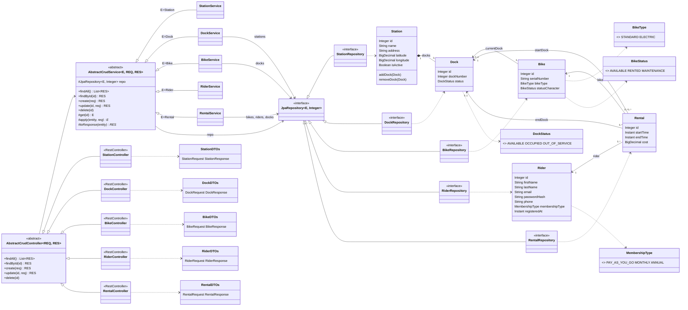

# City Bike – UML Class Diagram

Renders on GitHub (Mermaid). Layers: controller → service → repository → entity (controllers depend only on `AbstractCrudService`, services only on `JpaRepository`); DTOs cross the controller/service boundary.

`Found` (package-private helper in `service`) and `CityBikeApplication` (Spring Boot entry point) are omitted for clarity.
